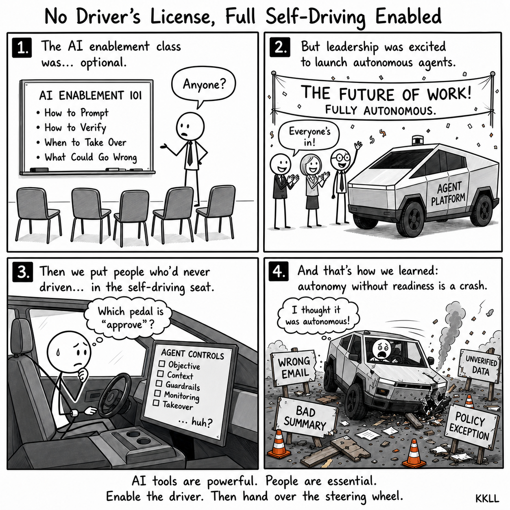
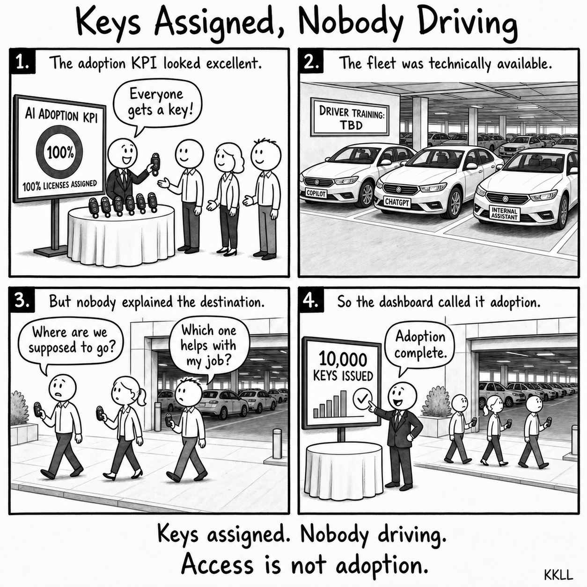
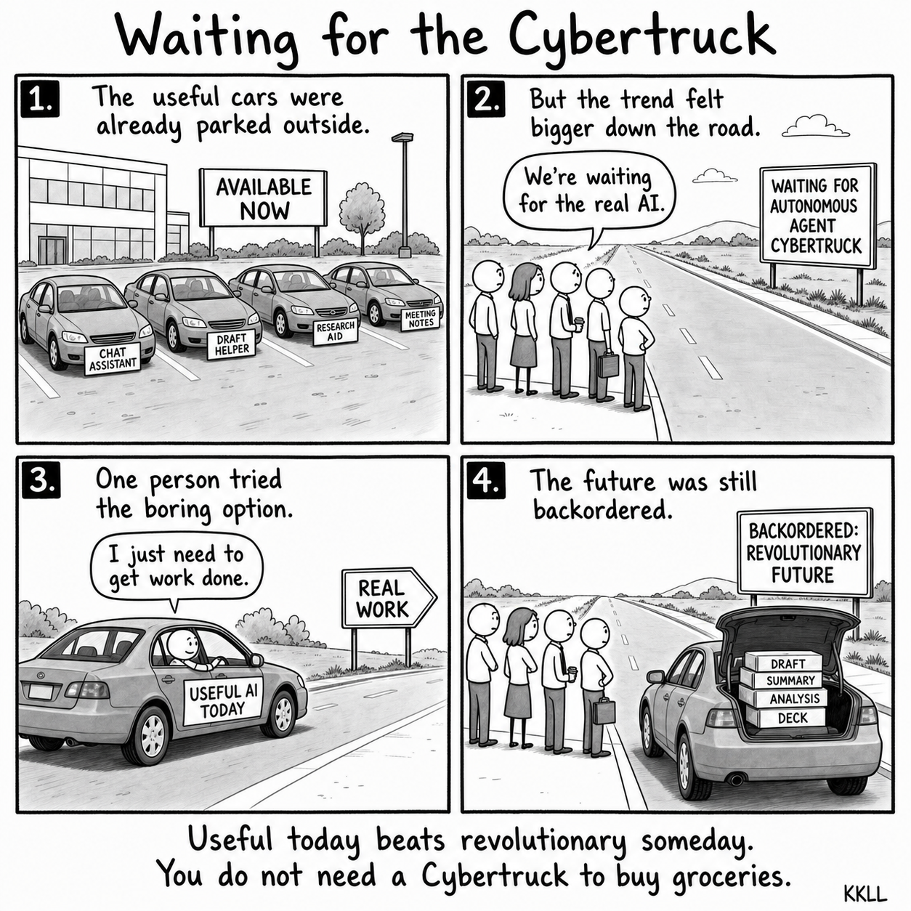
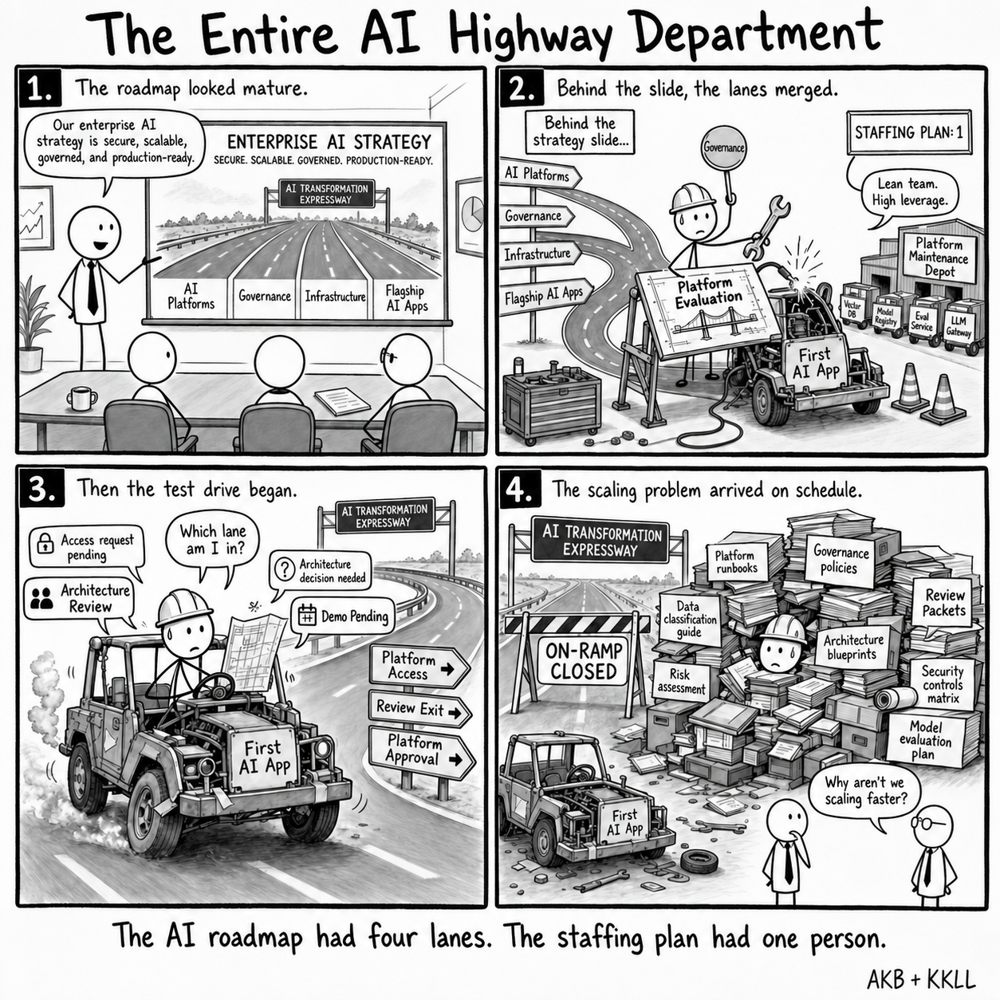
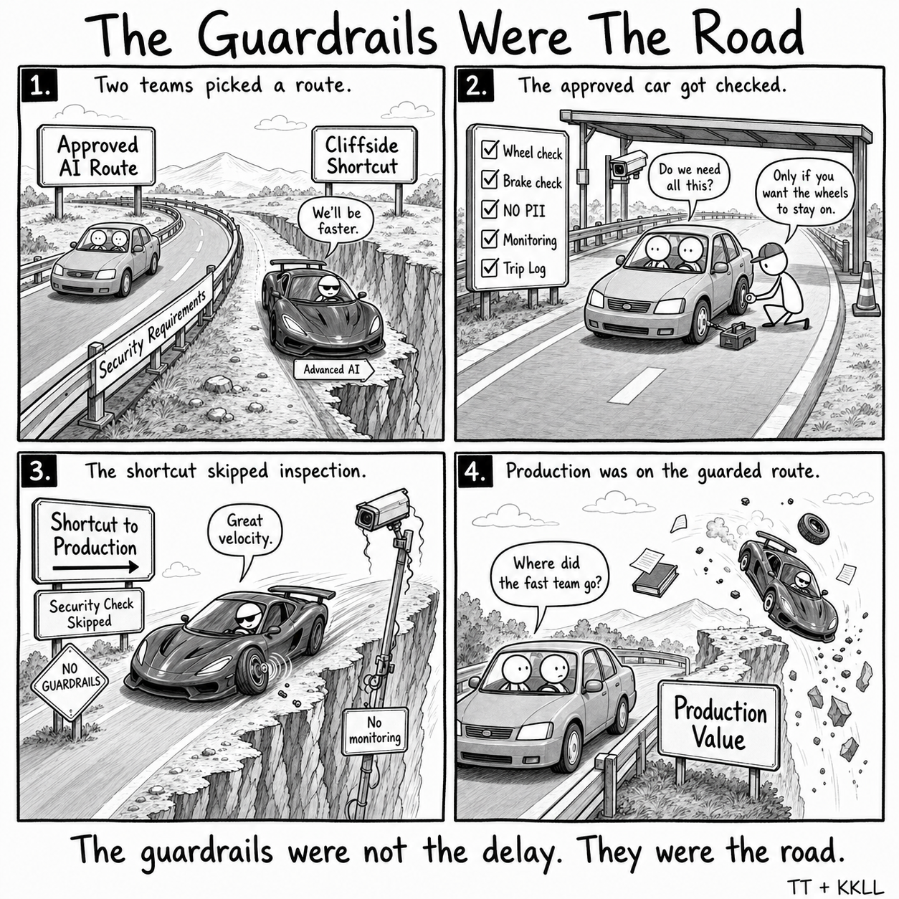
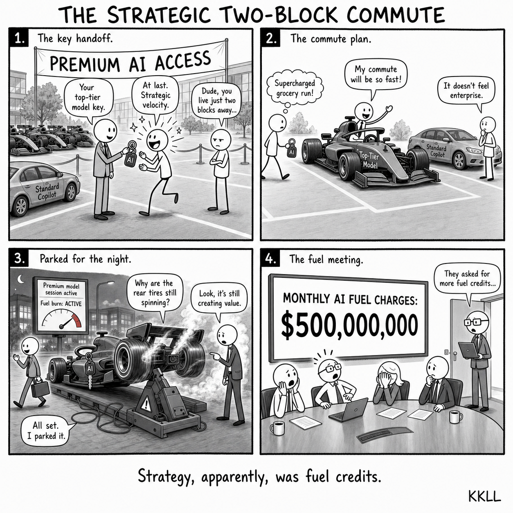
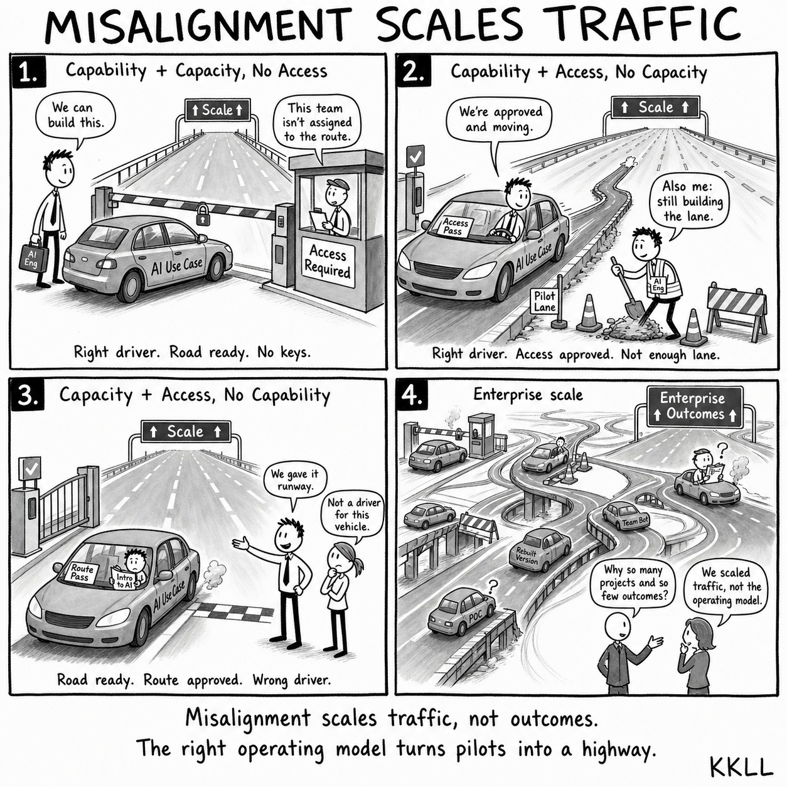
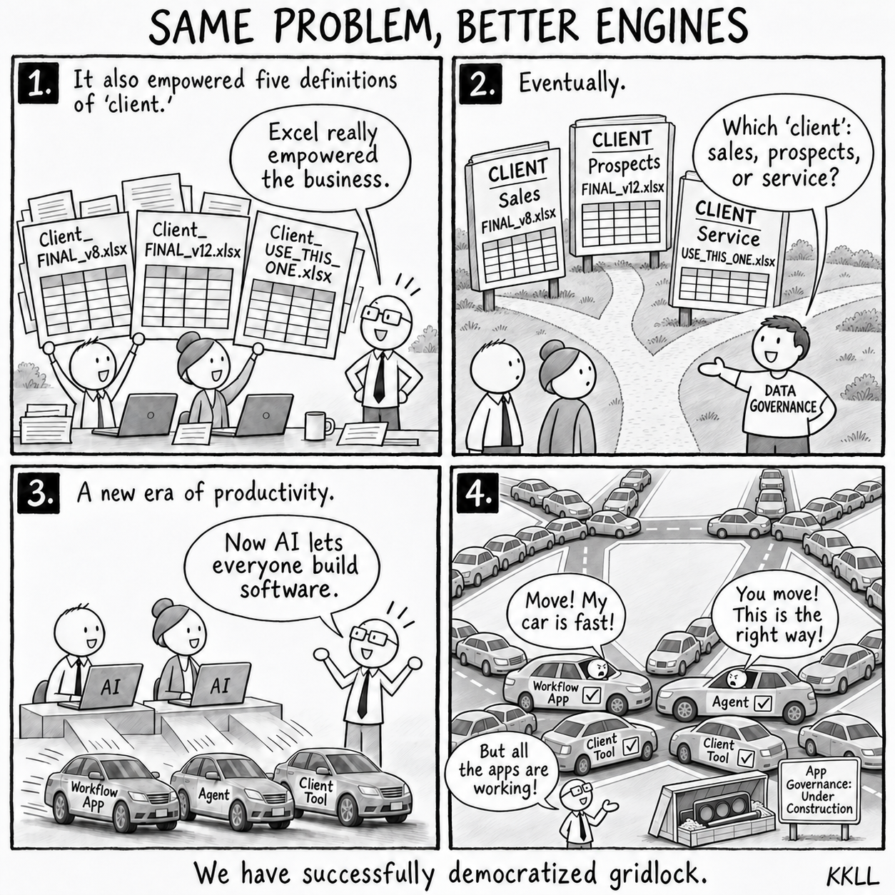
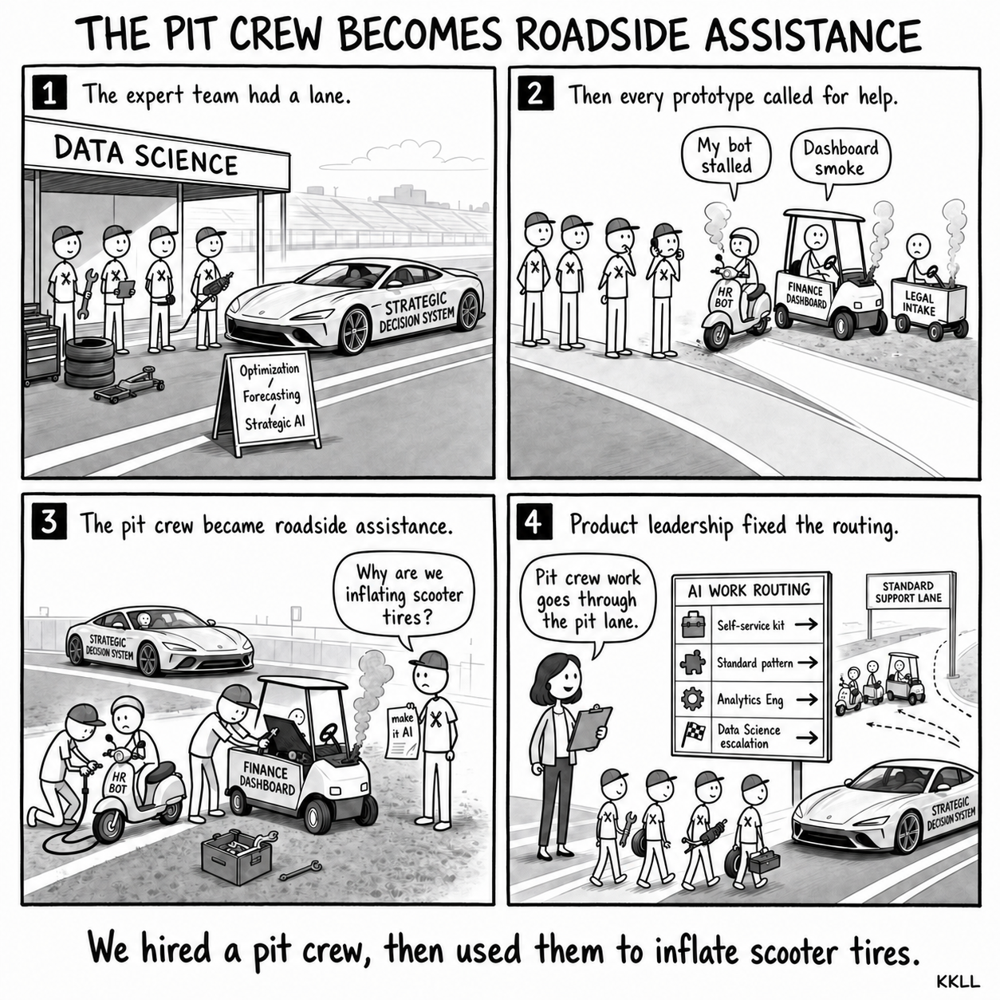

# Selected AI Vehicle Comics

Fictional industry satire about enterprise AI adoption and operating problems. All figures and organizations are illustrative. Source prompts and drafts are available for creative reuse.

## Comic 001: No Driver's License, Full Self-Driving Enabled

Enterprise organizations are rushing toward autonomous agents before they have taught employees how to use, verify, and safely supervise AI systems.

[Concept](../01_comic_backlog/001_no_drivers_license_full_self_driving.md) · [Generation prompt](../03_assets/concept_sketches/001_no_drivers_license_full_self_driving_prompt_v3_reference_style.md) · [PNG](../03_assets/selected_drafts/001_no_drivers_license_full_self_driving_signed.png)

## Comic 002: Keys Assigned, Nobody Driving

Assigning AI licenses is not the same as adoption, enablement, or business value.

[Concept](../01_comic_backlog/002_copilot_licenses_as_fleet_parking_permits.md) · [Generation prompt](../03_assets/concept_sketches/002_keys_assigned_nobody_driving_prompt_v1_reference_style.md) · [PNG](../03_assets/selected_drafts/002_keys_assigned_nobody_driving_signed.png)

## Comic 003: Waiting for the Cybertruck

Useful everyday AI assistants are already available, but organizations often ignore practical value while chasing more glamorous agentic systems.

[Concept](../01_comic_backlog/003_waiting_for_the_cybertruck.md) · [Generation prompt](../03_assets/concept_sketches/003_waiting_for_the_cybertruck_prompt_v1_reference_style.md) · [PNG](../03_assets/selected_drafts/003_waiting_for_the_cybertruck_signed.png)

## Comic 004: The Entire AI Highway Department

Enterprise AI ambition often outruns the operating capacity required to make it safe, scalable, and real.

[Concept](../01_comic_backlog/004_the_entire_ai_highway_department.md) · [Generation prompt](../03_assets/concept_sketches/004_the_entire_ai_highway_department_prompt_v1_reference_style.md) · [PNG](../03_assets/selected_drafts/004_the_entire_ai_highway_department.png)

## Comic 005: The Guardrails Were The Road

The approved AI route with security checks and guardrails may look slower, but it is the route that can actually reach production safely.

[Concept](../01_comic_backlog/005_the_guardrails_were_the_road.md) · [Generation prompt](../03_assets/concept_sketches/005_the_guardrails_were_the_road_prompt_v3_reference_style.md) · [PNG](../03_assets/selected_drafts/005_the_guardrails_were_the_road.png)

## Comic 015: The Strategic Two-Block Commute

Premium model access without judgment, enablement, model tiering, usage norms, cost controls, and monitoring turns enterprise strategy into fuel credits.

[Concept](../01_comic_backlog/015_formula_1_cars_for_two_block_commutes.md) · [Generation prompt](../03_assets/concept_sketches/015_the_strategic_two_block_commute_prompt_v3_reference_style.md) · [PNG](../03_assets/selected_drafts/015_the_strategic_two_block_commute_v3.png)

## Comic 016: Misalignment Scales Traffic

AI use cases scale only when the right driver has the right vehicle, permission to use the route, and enough road capacity to keep moving.

[Concept](../01_comic_backlog/016_misalignment_scales_traffic_not_outcomes.md) · [Generation prompt](../03_assets/concept_sketches/016_misalignment_scales_traffic_not_outcomes_prompt_v2_reference_style.md) · [PNG](../03_assets/selected_drafts/016_misalignment_scales_traffic_not_outcomes_v2.png)

## Comic 017: Same Problem, Better Engines

Local AI software creation succeeds while enterprise coordination infrastructure lags behind, repeating spreadsheet-era fragmentation.

[Concept](../01_comic_backlog/017_same_problem_better_engines.md) · [Generation prompt](../03_assets/concept_sketches/017_same_problem_better_engines_prompt_v1_reference_style.md) · [PNG](../03_assets/selected_drafts/017_same_problem_better_engines_v5_landmarks_readable_jams.png)

[Current revision prompt](../03_assets/concept_sketches/017_same_problem_better_engines_prompt_v5_landmarks_readable_jams.md)

## Comic 019: The Pit Crew Becomes Roadside Assistance

Expert technical teams need clear work routing so local prototype support does not displace strategic decision systems.

[Concept](../01_comic_backlog/019_pit_crew_becomes_roadside_assistance.md) · [Generation prompt](../03_assets/concept_sketches/019_pit_crew_becomes_roadside_assistance_prompt_v1_reference_style.md) · [PNG](../03_assets/selected_drafts/019_pit_crew_becomes_roadside_assistance_signed.png)

[Series framework](../README.md) · [Public-content rules](../../AGENTS.md#public-content-privacy-rules)
